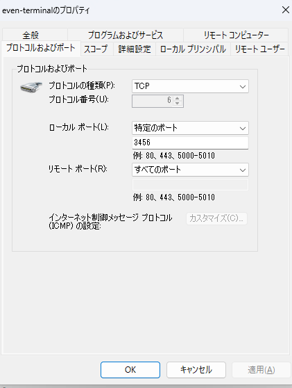
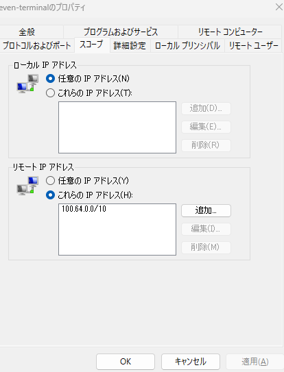
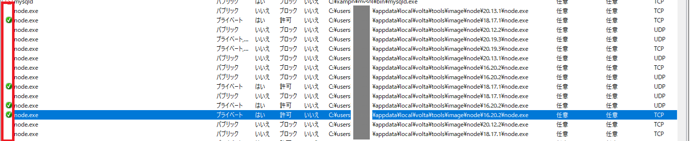

スマートグラスのEven G2で自宅のClaude Codeの操作を行う。
通常同一ネットワーク内からしかアクセスできないところを、
Tailscaleを使用して外出先からでも操作可能にすることができる。

しかしfirewall周りで躓いてしまったため、作業手順を残す。

## 手順

### 1. Tailscaleのインストール
外出先からデスクトップにアクセスできるよう、
スマホとデスクトップにそれぞれTailscaleをインストール。
Googleアカウント等でログインし、紐づけを行う。

### 2. Even関連のアプリを最新版に
バージョンが古いとどこかで失敗するので、それぞれ最新版に更新しておく

#### 1.Desktop

even-terminalのインストール

```sh
npm install -g @evenrealities/even-terminal
npm install -g @evenrealities/evenhub-cli
```

firewallの設定
「セキュリティが強化されたWindows Defenderファイアウォール」の設定に
even-terminalの設定を追加



また、この接続を阻害するnode系ブロック設定があれば無効化する



#### 2.スマホ
Evenアプリを更新。
ファームウェアも更新: めっちゃ時間がかかるので、スマホの自動ロックは解除しておく


### 3. 接続
Desktopで
```sh
#QRを生成
even-terminal --tailscale
```

スマホで、
Evenアプリ→Terminalモード→ホストを追加→右上からQRの読み取り

